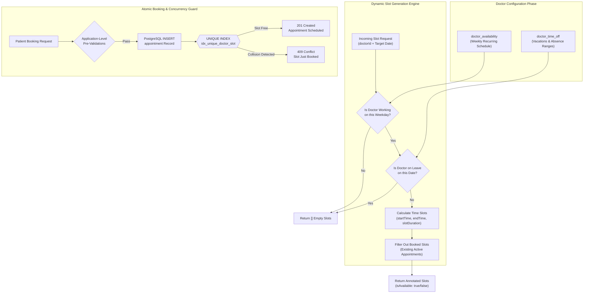
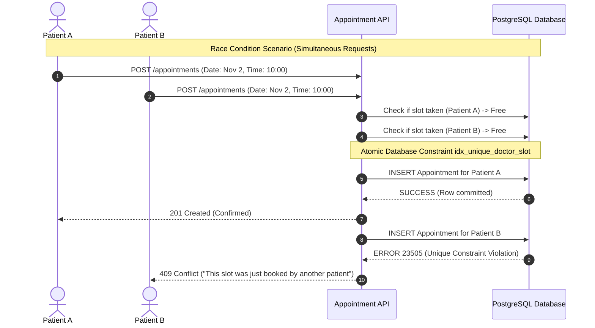
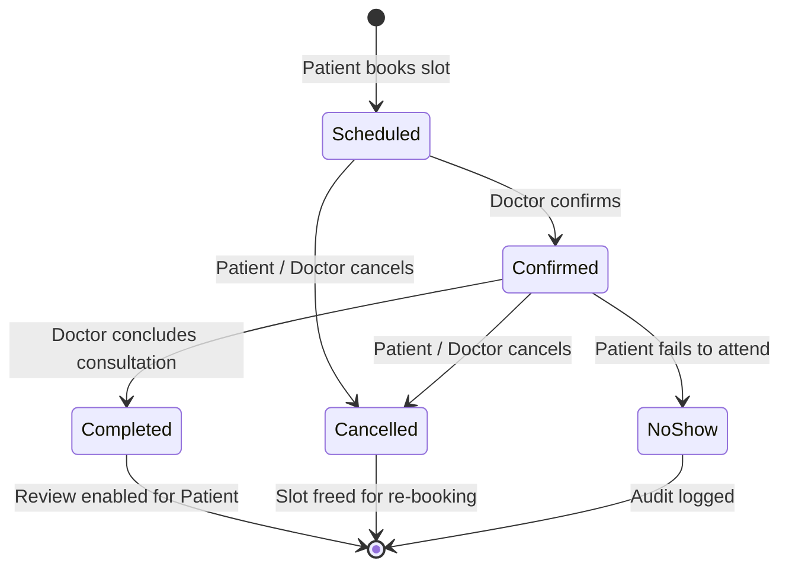

# Appointment Scheduling System

This document provides an in-depth technical explanation of the scheduling engine powering the Appointment Booking System. It details weekly availability rules, time-off handling, dynamic slot generation algorithms, atomic double-booking prevention, rescheduling workflows, and appointment status state machines.

---

## 1. Scheduling Domain Architecture

The scheduling engine coordinates four core data entities to calculate real-time slot availability and guarantee booking integrity:



---

## 2. Doctor Availability & Time-Off Rules

### 2.1. Weekly Working Schedules (`doctor_availability`)
Doctors configure recurring shifts for each day of the week (`monday` through `sunday`). Each record defines:
- `day_of_week`: Target day.
- `start_time` & `end_time`: Working hours (e.g., `09:00:00` to `17:00:00`).
- `slot_duration_minutes`: Length of each consultation (e.g., 15, 30, 45, or 60 minutes).
- `is_active`: Toggle switch allowing doctors to temporarily deactivate a day without dropping the template.

> [!NOTE]
> A compound unique constraint `idx_doctor_day_time (doctor_id, day_of_week, start_time)` ensures a doctor cannot inadvertently create overlapping duplicate shifts on the same day.

### 2.2. Vacation and Absence Overrides (`doctor_time_off`)
When a doctor takes leave, they register a date range:
- `start_date`: Beginning of absence (inclusive, `YYYY-MM-DD`).
- `end_date`: End of absence (inclusive, `YYYY-MM-DD`).
- `reason`: Clinical leave, holiday, or emergency.

During slot evaluation, any date falling within `[start_date, end_date]` immediately halts further calculation and returns zero available slots.

---

## 3. Slot Generation Algorithm

The slot calculation is executed server-side in [`getAvailableSlots()`](file:///c:/Users/Hp/OneDrive/Apps/appointment-booking/src/services/appointment.service.ts#L18-L88):

### Step-by-Step Execution:

1. **Weekday Resolution**:
   Given a requested date (e.g. `2026-11-02`), derive the weekday string (`"monday"`).
2. **Shift Availability Lookup**:
   Query `doctor_availability` matching `doctor_id`, `day_of_week`, and `is_active = true`. If no active shifts exist, return an empty array `[]`.
3. **Time-Off Interception**:
   Query `doctor_time_off` where `start_date <= date` and `end_date >= date`. If an active leave record is found, return `[]`.
4. **Existing Bookings Lookup**:
   Query `appointment` table for non-cancelled consultations:
   ```sql
   SELECT start_time, end_time 
   FROM appointment 
   WHERE doctor_id = $1 
     AND appointment_date = $2 
     AND status != 'cancelled';
   ```
   Collect all booked starting times into an in-memory `Set<string>`.
5. **Time Slot Subdivision**:
   For each active shift window, subdivide the duration using the helper function [`generateTimeSlots()`](file:///c:/Users/Hp/OneDrive/Apps/appointment-booking/src/lib/utils.ts):
   ```typescript
   export function generateTimeSlots(
     startTime: string,
     endTime: string,
     durationMinutes: number
   ): Array<{ start: string; end: string }> {
     const slots = [];
     let [currentH, currentM] = startTime.split(":").map(Number);
     const [endH, endM] = endTime.split(":").map(Number);
     const endTotalMinutes = endH * 60 + endM;

     while (currentH * 60 + currentM + durationMinutes <= endTotalMinutes) {
       const startStr = `${String(currentH).padStart(2, "0")}:${String(currentM).padStart(2, "0")}`;
       const nextMinutes = currentH * 60 + currentM + durationMinutes;
       const nextH = Math.floor(nextMinutes / 60);
       const nextM = nextMinutes % 60;
       const endStr = `${String(nextH).padStart(2, "0")}:${String(nextM).padStart(2, "0")}`;

       slots.push({ start: startStr, end: endStr });
       currentH = nextH;
       currentM = nextM;
     }
     return slots;
   }
   ```
6. **Availability Annotation**:
   Each generated slot is checked against `bookedTimes`:
   ```typescript
   allSlots.push({
     ...slot,
     isAvailable: !bookedTimes.has(slot.start),
   });
   ```

---

## 4. Double-Booking Prevention & Concurrency Control

In high-concurrency environments, application-level checks suffer from the **Time-of-Check to Time-of-Use (TOCTOU)** race condition: two patients can view an available 10:00 AM slot at the same second and submit booking requests simultaneously.



### The Database Constraint Defense:
To provide bulletproof concurrency safety without slow table-level locks, the system relies on a PostgreSQL unique B-tree index in [`src/db/schema/index.ts`](file:///c:/Users/Hp/OneDrive/Apps/appointment-booking/src/db/schema/index.ts#L226-L230):

```typescript
uniqueIndex("idx_unique_doctor_slot").on(
  table.doctorId,
  table.appointmentDate,
  table.startTime
)
```

### Service-Layer Exception Handling:
In [`bookAppointment()`](file:///c:/Users/Hp/OneDrive/Apps/appointment-booking/src/services/appointment.service.ts#L204-L215), the insert operation catches PostgreSQL unique violations and surfaces an intuitive client message:

```typescript
try {
  const results = await db.insert(appointment).values({ ... }).returning();
  return results[0];
} catch (error: unknown) {
  if (error instanceof Error && error.message.includes("unique")) {
    throw new Error(
      "This time slot was just booked by another patient. Please select a different time."
    );
  }
  throw error;
}
```

---

## 5. Appointment Status Lifecycle

The lifecycle of an appointment progresses through a deterministic finite-state machine governed by the `appointment_status` enum:



### Lifecycle Transition Rules:

| Initial State | Target State | Actor | Required Preconditions / Triggers |
| :--- | :--- | :--- | :--- |
| `[None]` | `scheduled` | Patient | Valid future date; doctor is accepting patients; slot free. |
| `scheduled` | `confirmed` | Doctor | Doctor reviews and formally acknowledges appointment. |
| `scheduled` / `confirmed` | `cancelled` | Patient / Doctor / Admin | Cancellation reason provided; appointment not yet completed. |
| `confirmed` | `completed` | Doctor | Consultation concluded; doctor submits optional clinical notes. |
| `confirmed` | `no_show` | Doctor | Appointment time elapsed without patient arrival. |

---

## 6. Cancellation and Rescheduling Workflows

### 6.1. Cancellation Workflow
Implemented in [`cancelAppointment()`](file:///c:/Users/Hp/OneDrive/Apps/appointment-booking/src/services/appointment.service.ts#L221-L257):
1. Verifies the appointment is not already `cancelled` or `completed`.
2. Sets `status = 'cancelled'`.
3. Records `cancelled_at = NOW()`, `cancelled_by = userId`, and `cancellation_reason = reason`.
4. Asynchronously triggers notification events to both parties (`notifyAppointmentCancelled()`).
5. Because cancelled appointments are excluded from `getAvailableSlots()`, the previously occupied slot becomes available for other patients.

### 6.2. Rescheduling Workflow
Implemented in [`rescheduleAppointment()`](file:///c:/Users/Hp/OneDrive/Apps/appointment-booking/src/services/appointment.service.ts#L262-L306):
1. Confirms the existing appointment is in an active state (`scheduled` or `confirmed`).
2. Marks the existing appointment as `cancelled` with the reason `"Rescheduled"`.
3. Calls `bookAppointment()` with the new `appointmentDate`, `startTime`, and `endTime`.
4. If the new slot fails validation or is already occupied, the transaction fails and the user is prompted to pick another slot.
5. Emits `appointment_rescheduled` notifications.
