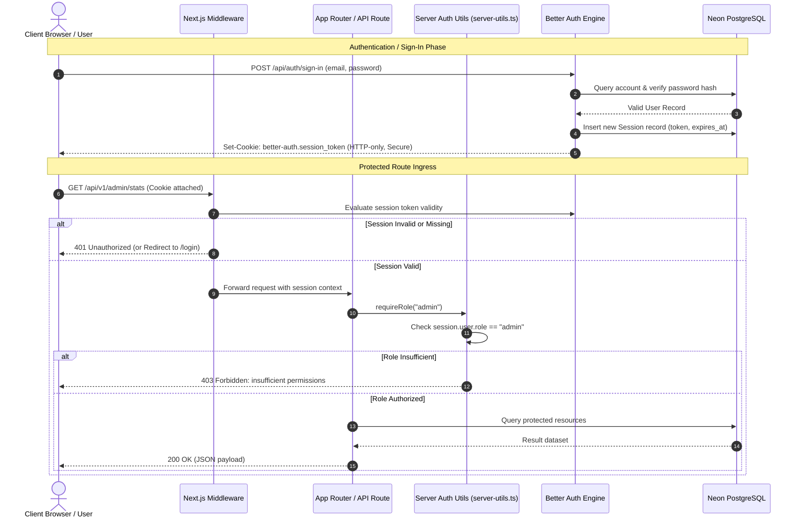
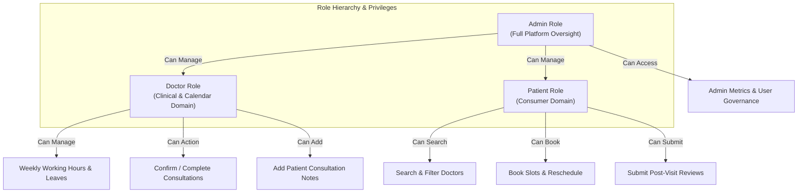

# Authentication and Authorization Guide

This document describes the security architecture, authentication lifecycle, session persistence, and Role-Based Access Control (RBAC) implementation for the Appointment Booking System, utilizing [Better Auth](file:///c:/Users/Hp/OneDrive/Apps/appointment-booking/src/lib/auth.ts) and [Drizzle ORM](file:///c:/Users/Hp/OneDrive/Apps/appointment-booking/src/lib/db.ts).

---

## 1. Security Architecture & Flow

The system employs a unified, cookie-based session authentication model with server-side session validation. All authentication actions pass through Better Auth, which interfaces directly with the PostgreSQL database via Drizzle ORM.



---

## 2. Better Auth Configuration

The server-side auth engine is instantiated in [`src/lib/auth.ts`](file:///c:/Users/Hp/OneDrive/Apps/appointment-booking/src/lib/auth.ts):

```typescript
import { betterAuth } from "better-auth";
import { drizzleAdapter } from "better-auth/adapters/drizzle";
import { db } from "@/lib/db";
import * as schema from "@/db/schema";

export const auth = betterAuth({
  database: drizzleAdapter(db, {
    provider: "pg",
    schema: {
      user: schema.user,
      session: schema.session,
      account: schema.account,
      verification: schema.verification,
    },
  }),
  emailAndPassword: {
    enabled: true,
    minPasswordLength: 8,
  },
  session: {
    expiresIn: 60 * 60 * 24 * 7, // 7 days rolling expiration
    updateAge: 60 * 60 * 24,     // Update timestamp once every 24 hours
    cookieCache: {
      enabled: true,
      maxAge: 5 * 60,            // 5-minute memory cache to minimize DB hits
    },
  },
  user: {
    additionalFields: {
      role: {
        type: "string",
        required: false,
        defaultValue: "patient",
        input: true,
      },
      phone: {
        type: "string",
        required: false,
        input: true,
      },
      dateOfBirth: {
        type: "string",
        required: false,
        input: true,
      },
      address: {
        type: "string",
        required: false,
        input: true,
      },
    },
  },
  trustedOrigins: [process.env.BETTER_AUTH_URL || "http://localhost:3000"],
});

export type Session = typeof auth.$Infer.Session;
```

### Key Architectural Rationale:
1. **Drizzle Adapter**: Binds Better Auth directly to the native `user`, `session`, `account`, and `verification` tables in PostgreSQL, preventing external ORM bloat.
2. **Extended User Schema**: Injects clinical attributes (`role`, `phone`, `dateOfBirth`, `address`) into the base user record upon registration.
3. **Session Cookie Caching**: Configured with a 5-minute cache (`cookieCache`) to avoid repetitive database round-trips for high-frequency API invocations.
4. **Origin Hardening**: Limits valid authentication origins strictly to `process.env.BETTER_AUTH_URL`.

---

## 3. Client-Side Authentication (`auth-client.ts`)

On the browser, client components interact with authentication state via [`src/lib/auth-client.ts`](file:///c:/Users/Hp/OneDrive/Apps/appointment-booking/src/lib/auth-client.ts):

```typescript
import { createAuthClient } from "better-auth/react";

export const authClient = createAuthClient({
  baseURL: process.env.NEXT_PUBLIC_APP_URL || "http://localhost:3000",
});

export const { signIn, signUp, signOut, useSession } = authClient;
```

### Client Usage Examples:

#### Sign-Up Form Hook:
```typescript
await signUp.email({
  email: data.email,
  password: data.password,
  name: data.name,
  role: data.role, // "patient" | "doctor"
  phone: data.phone,
  callbackURL: "/dashboard",
});
```

#### Session Inspection:
```typescript
const { data: session, isPending, error } = useSession();

if (isPending) return <SkeletonLoader />;
if (!session) return <Redirect to="/login" />;

return <div>Welcome back, {session.user.name} ({session.user.role})</div>;
```

---

## 4. Role-Based Access Control (RBAC)

The system enforces three distinct access tiers defined in the `user_role` enum:



### Privilege Matrix

| Operation / Endpoint | Patient | Doctor | Admin | Unauthenticated |
| :--- | :---: | :---: | :---: | :---: |
| Browse Doctors & Specialties | :white_check_mark: | :white_check_mark: | :white_check_mark: | :white_check_mark: |
| View Available Time Slots | :white_check_mark: | :white_check_mark: | :white_check_mark: | :white_check_mark: |
| Book Appointment | :white_check_mark: | :x: | :white_check_mark: | :x: |
| Cancel Own Appointment | :white_check_mark: | :white_check_mark: | :white_check_mark: | :x: |
| Reschedule Own Appointment | :white_check_mark: | :x: | :white_check_mark: | :x: |
| Confirm / Complete Appointment | :x: | :white_check_mark: | :white_check_mark: | :x: |
| Write Appointment Review | :white_check_mark: | :x: | :x: | :x: |
| Configure Work Shifts & Breaks | :x: | :white_check_mark: | :white_check_mark: | :x: |
| View System Metrics & Revenue | :x: | :x: | :white_check_mark: | :x: |
| Change User Roles | :x: | :x: | :white_check_mark: | :x: |

---

## 5. Server-Side Authorization Patterns

All route handlers and server actions enforce authorization via helper primitives in [`src/lib/server-utils.ts`](file:///c:/Users/Hp/OneDrive/Apps/appointment-booking/src/lib/server-utils.ts):

### 5.1. Session Extraction: `getServerSession()`
Retrieves and validates the active session from HTTP headers. Returns `null` if unauthenticated.
```typescript
export async function getServerSession() {
  const session = await auth.api.getSession({
    headers: await headers(),
  });
  return session;
}
```

### 5.2. Mandatory Authentication: `requireAuth()`
Guarantees a valid session exists; throws an `Unauthorized` error otherwise.
```typescript
export async function requireAuth() {
  const session = await getServerSession();
  if (!session) {
    throw new Error("Unauthorized");
  }
  return session;
}
```

### 5.3. Role Enforcement: `requireRole(role)` and `requireAnyRole(...roles)`
Asserts that the authenticated user possesses the required privilege tier.
```typescript
export async function requireRole(role: UserRole) {
  const session = await requireAuth();
  if ((session.user as unknown as { role: string }).role !== role) {
    throw new Error("Forbidden: insufficient permissions");
  }
  return session;
}
```

### 5.4. Route Handler Exception Wrapper: `withErrorHandler()`
Intercepts standard authorization exceptions and maps them to HTTP status codes (`401` and `403`):
```typescript
export function withErrorHandler(
  handler: (req: Request) => Promise<NextResponse>
) {
  return async (req: Request) => {
    try {
      return await handler(req);
    } catch (error: unknown) {
      const message =
        error instanceof Error ? error.message : "Internal server error";

      if (message === "Unauthorized") {
        return apiError(message, 401);
      }
      if (message.startsWith("Forbidden")) {
        return apiError(message, 403);
      }

      console.error("API Error:", error);
      return apiError(message, 500);
    }
  };
}
```

#### Canonical Route Handler Example:
```typescript
import { withErrorHandler, requireRole, apiSuccess } from "@/lib/server-utils";
import { getAdminStats } from "@/services/admin.service";

export const GET = withErrorHandler(async (req: Request) => {
  // Requires administrator role; returns 401 or 403 automatically on failure
  await requireRole("admin");
  const stats = await getAdminStats();
  return apiSuccess(stats);
});
```

---

## 6. Next.js Edge Middleware Protection

To protect UI pages and prevent unauthorized initial rendering, an Edge Middleware (`src/middleware.ts`) filters incoming page navigations:

```typescript
import { NextResponse } from "next/server";
import type { NextRequest } from "next/server";

export async function middleware(request: NextRequest) {
  const sessionToken = request.cookies.get("better-auth.session_token")?.value;
  const { pathname } = request.nextUrl;

  // 1. Guard authenticated route areas
  if (pathname.startsWith("/dashboard") || pathname.startsWith("/admin") || pathname.startsWith("/appointments")) {
    if (!sessionToken) {
      const loginUrl = new URL("/login", request.url);
      loginUrl.searchParams.set("callbackUrl", pathname);
      return NextResponse.redirect(loginUrl);
    }
  }

  // 2. Redirect logged-in users away from auth pages
  if (pathname === "/login" || pathname === "/register") {
    if (sessionToken) {
      return NextResponse.redirect(new URL("/dashboard", request.url));
    }
  }

  return NextResponse.next();
}

export const config = {
  matcher: [
    "/dashboard/:path*",
    "/admin/:path*",
    "/appointments/:path*",
    "/login",
    "/register",
  ],
};
```

---

## 7. Security Best Practices Implemented

1. **HttpOnly & SameSite Cookies**: Tokens cannot be read by client-side JavaScript (`document.cookie`), mitigating XSS session theft.
2. **Password Hashing**: Better Auth handles secure password hashing using adaptive salts and modern key-derivation algorithms (e.g., bcrypt/Argon2) before database insertion.
3. **Session Revocation**: Calling `signOut()` immediately deletes the session row from the PostgreSQL `session` table and clears the client cookie.
4. **Input Sanitization**: Password minimum length is enforced at both the Zod validation layer (8 characters) and the Better Auth core.
