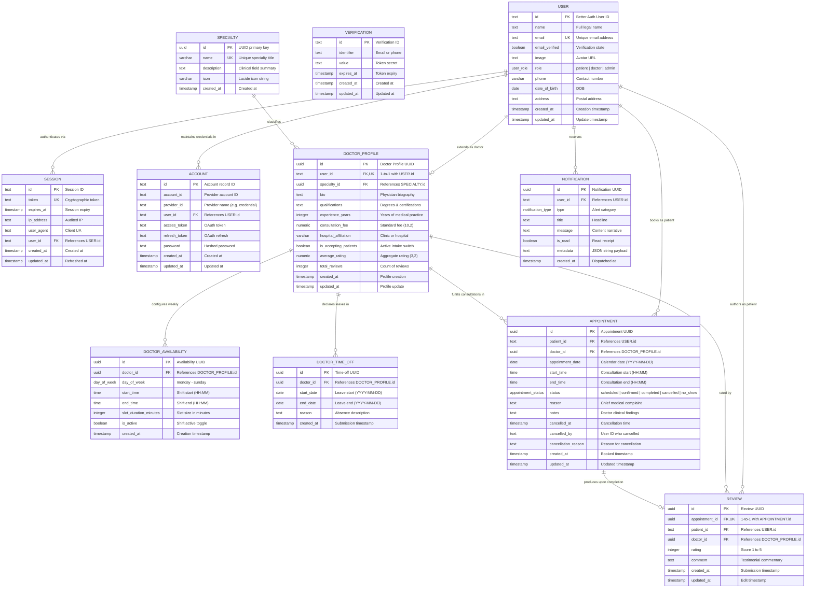

# Entity-Relationship (ER) Diagram

This document presents the formal Entity-Relationship (ER) model for the Appointment Booking System. The diagram and tables delineate the entities, key constraints, foreign key cardinalities, and data relationships powering the application.

---

## 1. Visual Entity-Relationship Diagram

---

## 2. Relational Cardinality & Participation Matrix

The following table summarizes the structural cardinalities, optionalities, and referential implications across all entities:

| Relationship | Cardinality | Parent Entity | Child Entity | Foreign Key Column | Nullable / Required |
| :--- | :--- | :--- | :--- | :--- | :--- |
| **User to Session** | `1 : N` (Zero or Many) | `user` | `session` | `session.user_id` | Required (`NOT NULL`) |
| **User to Account** | `1 : N` (Zero or Many) | `user` | `account` | `account.user_id` | Required (`NOT NULL`) |
| **User to Doctor Profile** | `1 : 1` (Zero or One) | `user` | `doctor_profile` | `doctor_profile.user_id` | Required, Unique (`NOT NULL`, `UNIQUE`) |
| **Specialty to Doctor Profile** | `1 : N` (Zero or Many) | `specialty` | `doctor_profile` | `doctor_profile.specialty_id` | Required (`NOT NULL`) |
| **Doctor Profile to Availability** | `1 : N` (Zero or Many) | `doctor_profile` | `doctor_availability` | `doctor_availability.doctor_id` | Required (`NOT NULL`) |
| **Doctor Profile to Time-Off** | `1 : N` (Zero or Many) | `doctor_profile` | `doctor_time_off` | `doctor_time_off.doctor_id` | Required (`NOT NULL`) |
| **Patient to Appointment** | `1 : N` (Zero or Many) | `user` | `appointment` | `appointment.patient_id` | Required (`NOT NULL`) |
| **Doctor Profile to Appointment** | `1 : N` (Zero or Many) | `doctor_profile` | `appointment` | `appointment.doctor_id` | Required (`NOT NULL`) |
| **Appointment to Review** | `1 : 1` (Zero or One) | `appointment` | `review` | `review.appointment_id` | Required, Unique (`NOT NULL`, `UNIQUE`) |
| **Patient to Review** | `1 : N` (Zero or Many) | `user` | `review` | `review.patient_id` | Required (`NOT NULL`) |
| **Doctor Profile to Review** | `1 : N` (Zero or Many) | `doctor_profile` | `review` | `review.doctor_id` | Required (`NOT NULL`) |
| **User to Notification** | `1 : N` (Zero or Many) | `user` | `notification` | `notification.user_id` | Required (`NOT NULL`) |

---

## 3. Structural Analysis & Design Rationale

### 3.1. User Role Polymorphism vs. Specialized Extension
The design isolates base authentication concerns (`id`, `name`, `email`, `role`) within `user`, while extending medical domain properties (`specialty_id`, `consultation_fee`, `bio`) into the 1-to-1 child table `doctor_profile`:
- Patients remain lightweight records with no extraneous empty doctor fields.
- Administrators utilize the core `user` table without needing synthetic clinical rows.
- Doctors enjoy relational integrity (`doctor_profile.user_id` is both `NOT NULL` and `UNIQUE`).

### 3.2. Appointment Slot Integrity
Appointments link `patient_id` directly to `user.id`, and `doctor_id` to `doctor_profile.id`. The critical constraint `idx_unique_doctor_slot (doctor_id, appointment_date, start_time)` operates directly on the `appointment` table:
- Even if two patients request the same 10:00 AM slot on 2026-11-01 simultaneously, the PostgreSQL B-tree index rejects the second transaction with error code `23505` (unique violation).

### 3.3. Review Verification Boundary
The `review` table requires a non-null, unique foreign key `appointment_id`:
- Prevents spam reviews: A review can never exist without a corresponding valid consultation record.
- Prevents review duplication: An appointment cannot be evaluated twice.
- Enforces patient validity: The service layer asserts that `appointment.status == 'completed'` before permitting review creation.
