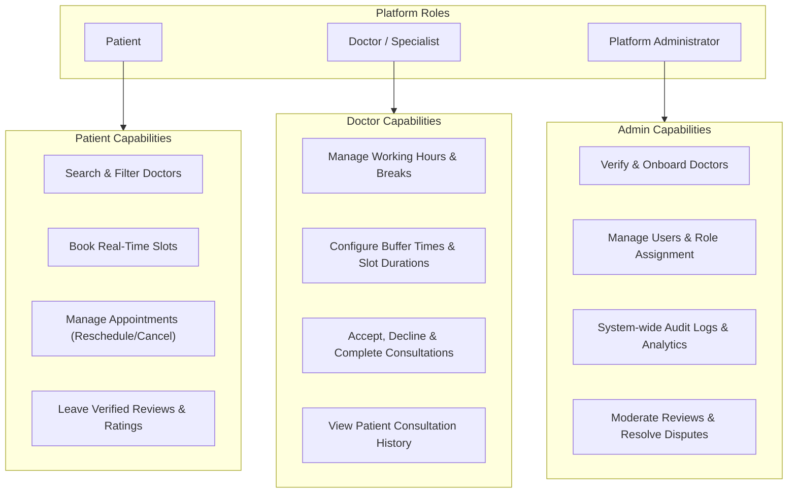
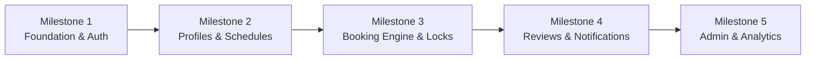

# Project Overview: Appointment Booking System

## 1. Executive Summary

The **Appointment Booking System** is an enterprise-grade, modern healthcare and professional appointment scheduling platform designed to streamline interactions between **Patients**, **Doctors (Healthcare Providers)**, and **Administrators**. 

Built with the modern web stack—**Next.js 16 (App Router)**, **TypeScript (Strict Mode)**, **Tailwind CSS**, **shadcn/ui**, **Drizzle ORM**, **PostgreSQL on Neon**, and **Better Auth**—the system eliminates double-booking, minimizes administrative overhead, and provides an intuitive, accessible experience across mobile and desktop devices.

---

## 2. Core Value Proposition

- **For Patients**: Effortless discovery of medical specialists by field, rating, and real-time availability; one-click appointment scheduling with instant confirmation; transparent fee structures; and streamlined rescheduling and cancellation.
- **For Doctors**: Complete autonomy over consultation calendars, granular slot duration and buffer controls, automated avoidance of scheduling conflicts, patient history visibility, and status tracking (Pending, Confirmed, Completed, Cancelled).
- **For Administrators**: Centralized governance, doctor verification and onboarding workflows, system-wide analytics on booking volume and platform utilization, and audit capabilities.

---

## 3. User Roles & Key Capabilities

### 3.1. Patient Experience
- **Doctor Discovery**: Filter by medical specialty (e.g., Cardiology, Dermatology, Pediatrics), consultation fee, language, gender, and available date ranges.
- **Dynamic Slot Selection**: Interactive calendar displaying only genuinely vacant slots computed in real time from doctor availability rules and existing bookings.
- **Appointment Management**: View upcoming and historical consultations, download appointment summaries, request rescheduling, or cancel within allowed notice periods.
- **Feedback Loop**: Post-consultation verified reviews with 1–5 star ratings and clinical feedback comments.

### 3.2. Doctor Experience
- **Schedule Customization**: Set recurring weekly working schedules (e.g., Mon–Fri 09:00–17:00), lunch breaks, and per-date overrides (vacation, emergency leaves).
- **Buffer & Duration Rules**: Configurable consultation slot durations (e.g., 15, 30, 45, 60 minutes) and automatic buffer times between appointments (e.g., 10 minutes) to prevent burnout.
- **Appointment Lifecycle**: Review incoming booking requests, mark consultations as completed, add private clinical notes, or cancel with reason notices.

### 3.3. Administrator Experience
- **Credential Verification**: Review medical licenses, certifications, and background verification before approving doctor profiles for public search.
- **Platform Analytics**: Track appointment volume, active users, cancellation rates, peak booking hours, and revenue trends.
- **System Governance**: Manage user accounts, enforce security policies, moderate abusive reviews, and view system health.

---

## 4. Technology Stack & Rationale

| Layer | Technology | Version / Tooling | Architectural Rationale |
| :--- | :--- | :--- | :--- |
| **Framework** | Next.js (App Router) | `16.x` / React `19.x` | Combines React Server Components (RSC) for fast initial loads with Server Actions for mutations and Route Handlers for REST APIs. |
| **Language** | TypeScript | `5.x` (Strict Mode) | End-to-end type safety across client UI, server actions, services, and database queries. Eliminates runtime type errors. |
| **Styling** | Tailwind CSS | `v4.x` | High-performance atomic utility CSS offering responsive layout generation and seamless CSS variable theming. |
| **UI Components** | shadcn/ui | Radix UI Primitives | Accessible, unstyled, composable UI primitives owned directly in the source tree with full customization control. |
| **Icons** | Lucide React | Latest | Consistent, lightweight SVG iconography tailored for healthcare, calendar, and UI action triggers. |
| **ORM** | Drizzle ORM | Latest (`drizzle-orm`) | Lightweight, zero-overhead TypeScript ORM with native SQL expression support, automatic migrations, and relation querying. |
| **Database** | PostgreSQL on Neon | Serverless Postgres | High-availability cloud PostgreSQL with instant branching, automated scaling, and low-latency connection pooling. |
| **Authentication** | Better Auth | Latest | Modern, framework-native TypeScript auth library supporting session management, secure cookies, and Role-Based Access Control (RBAC). |
| **Form Handling** | React Hook Form | Latest | Uncontrolled form inputs with minimal re-renders, seamlessly paired with schema validation. |
| **Validation** | Zod | Latest | Composable, runtime schema validation shared between client-side forms, Server Actions, and REST Route Handlers. |
| **Toasts / Alerts** | Sonner | Latest | Smooth, performant, accessible toast notification stack supporting promise tracking and theme integration. |

---

## 5. Architectural Highlights

### 5.1. Concurrency & Double-Booking Prevention
A core technical challenge in appointment booking is simultaneous booking attempts for the same time slot. The system solves this at the database level using:
1. **Atomic Slot Reservation**: Database transactions utilizing PostgreSQL row-level locks (`SELECT FOR UPDATE`) or unique compound exclusion constraints on `(doctor_id, start_time, end_time)` for active bookings.
2. **Pre-booking Availability Evaluation**: Dynamically calculating free intervals factoring in weekly rules, calendar overrides, and booked appointments.

### 5.2. Unified Full-Stack Architecture
Next.js 16 acts as both front-end and back-end host:
- **Server Actions**: Primary driver for UI-driven mutations (booking a slot, saving profile updates, changing appointment status).
- **REST Route Handlers (`/api/v1/*`)**: Standardized HTTP endpoints for external integrations, mobile apps, or background automation.
- **Shared Service Layer**: Both Server Actions and Route Handlers consume the exact same underlying service functions (`AppointmentService`, `DoctorService`, `AuthService`), preventing code duplication and diverging business logic.

---

## 6. Project Roadmap

1. **Milestone 1: Foundation & Authentication**
   - Project scaffolding, Tailwind CSS + shadcn/ui theme setup.
   - Database schema definition with Drizzle ORM & Neon connection.
   - Better Auth setup with Email/Password, Sessions, and Role tables (`patient`, `doctor`, `admin`).
2. **Milestone 2: Doctor Profiles & Availability Management**
   - Doctor profile customization (specialties, fees, bio, credentials).
   - Weekly working hours definition, break times, and holiday overrides.
   - Doctor search directory with client-side and server-side filtering.
3. **Milestone 3: Booking Engine & Double-Booking Prevention**
   - Dynamic time-slot generator engine.
   - Concurrency-safe appointment booking with PostgreSQL transaction isolation.
   - Rescheduling and cancellation workflows.
4. **Milestone 4: Reviews, Ratings & Notifications**
   - Post-consultation verified reviews.
   - In-app notification feeds and transactional emails.
   - Patient appointment history dashboard.
5. **Milestone 5: Admin Dashboard & Production Readiness**
   - Doctor verification queue and platform governance tools.
   - Aggregate metric charts (revenue, bookings, cancellations).
   - Full automated test suite and security audit.
