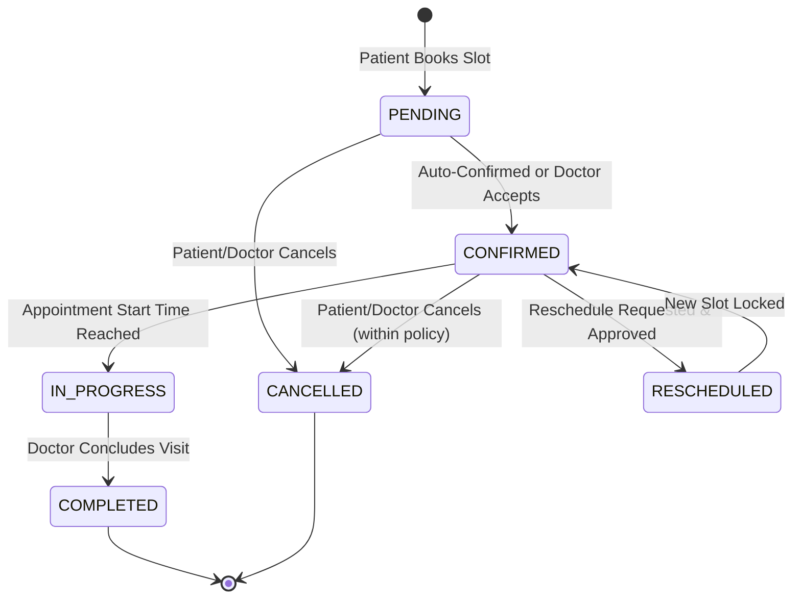

# System Requirements Specification: Appointment Booking System

## 1. Introduction

This document provides a comprehensive specification of the **Functional Requirements (FR)** and **Non-Functional Requirements (NFR)** for the multi-tenant Appointment Booking System. It defines the software capabilities, user roles, operational workflows, and security/performance constraints required to deliver a reliable, enterprise-grade medical scheduling service.

---

## 2. User Roles & Permission Matrix

The system distinguishes three primary personas: **Patient**, **Doctor**, and **Admin**.

| Feature / Resource | Patient | Doctor | Platform Admin |
| :--- | :---: | :---: | :---: |
| **Self Registration & Profile Setup** | ✅ | ✅ (Requires Admin Approval) | ❌ (Internal Provisioning) |
| **Browse Doctor Directory & Schedules** | ✅ | ✅ | ✅ |
| **Book Appointment Slot** | ✅ | ❌ | ✅ (On behalf of patient) |
| **Cancel / Reschedule Own Appointment** | ✅ (Subject to policy) | ✅ (With patient notice) | ✅ (Override permissions) |
| **Set Availability & Buffer Rules** | ❌ | ✅ | ✅ (Assistive support) |
| **View Patient Medical Notes** | Own only | Assigned patients only | ❌ (HIPAA / Privacy restricted) |
| **Submit Rating & Review** | ✅ (After completed visit) | ❌ | ❌ |
| **Respond to Review** | ❌ | ✅ (Public response) | ❌ |
| **Approve / Suspend Doctor Profiles** | ❌ | ❌ | ✅ |
| **System Audit Logs & Metrics** | ❌ | ❌ | ✅ |

---

## 3. Functional Requirements

### 3.1. Authentication & Identity Management

#### FR-1.1: Registration & Account Creation
- **Description**: Users must be able to register using their email address, secure password, and primary role (`patient` or `doctor`).
- **Validation**:
  - Passwords must be at least 8 characters long, containing uppercase, lowercase, numeric, and special characters.
  - Email addresses must be unique and validated using standard RFC 5322 regex.
- **Doctor Registration Workflow**: Doctor registrations are created in `PENDING_VERIFICATION` status until reviewed and approved by an Administrator.

#### FR-1.2: Authentication & Session Management
- **Description**: Secure login powered by **Better Auth** using HTTP-only, secure, same-site session cookies.
- **Session Expiry**: Inactive sessions expire after 7 days; active sessions refresh automatically on user activity.
- **Role Redirection**: Post-login redirection sends Patients to `/dashboard/patient`, Doctors to `/dashboard/doctor`, and Admins to `/dashboard/admin`.

#### FR-1.3: Password Recovery
- **Description**: Users can request a time-limited (15-minute validity) cryptographically signed password reset link sent to their registered email.

---

### 3.2. Doctor Profile & Specialties Management

#### FR-2.1: Doctor Profile Configuration
- **Description**: Doctors must maintain a rich professional profile containing:
  - Personal Information: Full Name, Title (e.g., Dr., MD), Avatar/Profile Photo.
  - Medical Specialties: Primary and secondary fields (e.g., Cardiology, Pediatrics, Neurology, Dermatology).
  - Credentials: Medical License Number, Issuing Board, Education, Years of Experience.
  - Consultation Details: Physical clinic address, virtual consultation support (video/telehealth link), consultation fee per standard slot.
  - Biography: Formatted biography and languages spoken.

#### FR-2.2: Directory Search & Filtering
- **Description**: Patients and guests can discover doctors using multi-faceted search criteria:
  - Search by doctor name or clinic name.
  - Filter by medical specialty.
  - Filter by consultation fee range (min/max).
  - Filter by date of availability (e.g., "Available today", "Available this week").
  - Filter by minimum patient rating (e.g., 4+ stars).

---

### 3.3. Availability & Working Hours Management

#### FR-3.1: Recurring Weekly Schedules
- **Description**: Doctors can specify default working hours for each day of the week (Sunday through Saturday).
- **Sub-Intervals**: Support for multiple working shifts per day (e.g., 09:00–12:00 and 14:00–18:00) with automatic break exclusion.

#### FR-3.2: Slot Duration & Buffer Times
- **Description**: Doctors can configure:
  - **Slot Duration**: 15, 30, 45, or 60 minutes per consultation.
  - **Buffer Time**: Mandatory rest or preparation buffer (e.g., 10 or 15 minutes) automatically appended after each consultation.
  - **Advance Booking Window**: Minimum advance notice required (e.g., at least 2 hours prior) and maximum booking horizon (e.g., up to 60 days into the future).

#### FR-3.3: Specific Date Overrides & Blackouts
- **Description**: Doctors can declare custom date-specific rules:
  - Mark specific days as non-working holidays or vacation days.
  - Define custom non-standard working hours for specific dates.

---

### 3.4. Appointment Booking & Double-Booking Prevention

#### FR-4.1: Slot Calculation Engine
- **Description**: Dynamic generation of available booking slots by taking the doctor's active schedule, subtracting booked appointments (`PENDING`, `CONFIRMED`), subtracting breaks and buffer times, and excluding past slots.

#### FR-4.2: Double-Booking Prevention & Concurrency Control
- **Description**: The system must guarantee that no two patients can successfully book overlapping time intervals for the same doctor under any concurrent traffic conditions.
- **Acceptance Criteria**:
  - Slot reservation executed within an ACID database transaction.
  - Row-level lock (`SELECT ... FOR UPDATE`) or PostgreSQL compound timestamp exclusion constraint (`tsrange` overlaps) applied at the time of reservation.
  - In the event of a race condition, the second transaction is aborted with a user-friendly error message: *"This slot was just reserved by another patient. Please select an alternate time."*

#### FR-4.3: Booking Confirmation
- **Description**: Upon successful reservation:
  - The appointment record is generated with a unique reference code (e.g., `APT-2026-X8Y9Z`).
  - An email notification with calendar invite (.ics format) is dispatched to both patient and doctor.
  - The slot is immediately removed from subsequent availability queries.

---

### 3.5. Appointment Cancellation & Rescheduling

#### FR-5.1: Patient Cancellation
- **Description**: Patients may cancel an upcoming appointment subject to platform cancellation policies (e.g., up to 12 hours prior to scheduled start time).
- **Action**: Appointment status updates to `CANCELLED`, slot is immediately released for re-booking, and reason for cancellation is recorded.

#### FR-5.2: Doctor Cancellation
- **Description**: Doctors can cancel scheduled appointments in emergencies. A cancellation reason must be provided, and an automated alert is sent to the patient with a priority rescheduling link.

#### FR-5.3: Rescheduling Workflow
- **Description**: Patients or doctors can initiate a reschedule request. 
- **Atomic Swap**: The existing slot remains locked until the replacement slot is selected and confirmed, at which point the original slot is released and the new slot is locked in a single atomic transaction.

---

### 3.6. Reviews & Ratings System

#### FR-6.1: Verified Reviews
- **Description**: Only patients who have completed an appointment (`status = COMPLETED`) are eligible to submit a review for that doctor. One review per completed appointment.

#### FR-6.2: Rating Metrics & Comments
- **Description**: Reviews include:
  - Numeric star rating (1 to 5 stars).
  - Written review comment (optional or required, min 10 characters, max 1,000 characters).
  - Anonymity toggle (allows patient to hide full name from public view).

#### FR-6.3: Doctor Public Response
- **Description**: Doctors can submit a single official public response to a patient review.

---

### 3.7. Notifications System

#### FR-7.1: Multi-Channel Alerts
- **Description**: Dispatches in-app notifications and transactional emails for key events:
  - Appointment booked / pending confirmation.
  - Appointment confirmed or rescheduled.
  - Appointment reminder (24 hours and 1 hour prior).
  - Appointment cancellation notice.
  - Doctor review received.

#### FR-7.2: In-App Notification Center
- **Description**: Bell icon in navigation header with unread badge count, popover list of latest notifications, and "Mark all as read" capability.

---

### 3.8. Platform Administration & Governance

#### FR-8.1: Doctor Verification Workflow
- **Description**: Administrators can review doctor applications, inspect uploaded credentials, approve profiles to go live, or reject with detailed feedback.

#### FR-8.2: User Management
- **Description**: Admins can search, view, suspend, or reactivate user accounts across all roles.

#### FR-8.3: Platform Metrics & Reporting
- **Description**: Dashboard presenting aggregated statistics:
  - Total bookings today, this week, this month.
  - Booking status breakdown (Completed vs Cancelled vs Pending).
  - Active doctors vs pending verification requests.
  - System performance and error logs.

---

## 4. Non-Functional Requirements (NFR)

### 4.1. Performance & Scalability (NFR-1)
- **NFR-1.1 Response Time**: Server-rendered pages must achieve First Contentful Paint (FCP) in under 1.2 seconds under standard broadband conditions.
- **NFR-1.2 API Latency**: REST API endpoints and Server Actions must respond in under 250ms for 95% of requests ($p95$).
- **NFR-1.3 Availability Query Speed**: Slot calculation algorithms must execute in under 80ms for a 30-day window per doctor.
- **NFR-1.4 Connection Pooling**: Must use Neon's serverless connection pooler to prevent connection exhaustion during traffic bursts.

### 4.2. Security & Compliance (NFR-2)
- **NFR-2.1 Transport Security**: Strict HTTPS enforcement with TLS 1.3 for all communications.
- **NFR-2.2 Data Protection & Privacy**: Sensitive patient notes and personal contact info must be protected in transit and at rest.
- **NFR-2.3 Authentication Security**: Better Auth session tokens stored in `HttpOnly`, `Secure`, `SameSite=Lax` cookies to prevent XSS exfiltration.
- **NFR-2.4 Injection Protection**: Drizzle ORM parameterized queries prevent SQL injection. Zod schemas validate all inputs to prevent prototype pollution and malformed payloads.
- **NFR-2.5 CSRF & Rate Limiting**: Anti-CSRF protections on all mutation endpoints; rate limiting on authentication and booking endpoints (e.g., maximum 5 failed logins per 10 minutes per IP).

### 4.3. Reliability & Data Integrity (NFR-3)
- **NFR-3.1 High Availability**: Platform availability target of 99.9% uptime.
- **NFR-3.2 ACID Compliance**: All appointment slot allocations, payments, and cancellations executed within strict PostgreSQL database transactions.
- **NFR-3.3 Graceful Degradation**: Clear user feedback via toast notifications and fallback UI in the event of upstream network failures or third-party service degradation.

### 4.4. Usability & Accessibility (NFR-4)
- **NFR-4.1 Accessibility Standard**: Compliance with WCAG 2.1 Level AA guidelines.
- **NFR-4.2 Keyboard Navigation**: Full interactive workflow (calendar date picking, time slot selection, form completion) navigable via keyboard.
- **NFR-4.3 Mobile-First Responsiveness**: Fully functional layout from 320px mobile screens to 4K desktop displays.
- **NFR-4.4 Screen Reader Support**: Form inputs labeled with clear ARIA attributes (`aria-required`, `aria-invalid`, `aria-describedby`).

### 4.5. Maintainability & Code Quality (NFR-5)
- **NFR-5.1 Strict Type Checking**: TypeScript compiler configured in `strict` mode with zero implicit `any` allowances.
- **NFR-5.2 Service Layer Separation**: Direct database queries forbidden inside UI components; all business logic must reside within dedicated service modules.
- **NFR-5.3 Schema Migration Traceability**: All database schema alterations managed and versioned using Drizzle Kit migrations.
