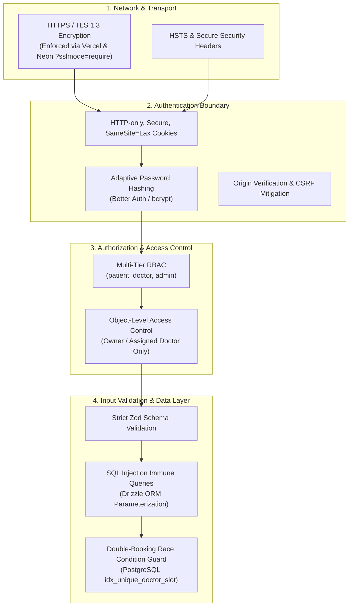

# Security Architecture & Best Practices

This document outlines the security controls, defensive patterns, and regulatory safeguards implemented across the Appointment Booking System to protect patient data, prevent unauthorized access, and ensure clinical data integrity.

---

## 1. Security Architecture Overview

The system implements defense-in-depth across eight distinct protective layers:



---

## 2. Authentication & Password Security

### 2.1. Password Hashing and Key Derivation
- Passwords are never stored in plaintext. [Better Auth](file:///c:/Users/Hp/OneDrive/Apps/appointment-booking/src/lib/auth.ts) hashes passwords using adaptive, computationally intensive algorithms (e.g. bcrypt or Argon2) with cryptographically secure random salts.
- A minimum password length of **8 characters** is strictly enforced at both the Zod validation layer ([`src/lib/validations.ts`](file:///c:/Users/Hp/OneDrive/Apps/appointment-booking/src/lib/validations.ts#L7)) and the Better Auth configuration.

### 2.2. Session Cookie Hardening
Web sessions avoid vulnerable localStorage mechanisms. Instead, tokens reside in browser cookies configured with stringent security attributes:
- `HttpOnly = true`: Shields the cookie from client-side JavaScript execution, eliminating token theft via Cross-Site Scripting (XSS).
- `Secure = true`: In production, cookies are transmitted exclusively over encrypted HTTPS connections.
- `SameSite = Lax`: Prevents unauthorized third-party origins from sending the cookie in cross-site requests, mitigating Cross-Site Request Forgery (CSRF).
- `Rolling Expiration`: Sessions expire after 7 days (`expiresIn: 60 * 60 * 24 * 7`) and refresh their validity timestamp every 24 hours (`updateAge: 60 * 60 * 24`).

### 2.3. CSRF & Origin Validation
Better Auth asserts that incoming mutation requests match `trustedOrigins`:
```typescript
trustedOrigins: [process.env.BETTER_AUTH_URL || "http://localhost:3000"]
```
Requests originating from unexpected domains are rejected before reaching application handlers.

---

## 3. Authorization & Object-Level Access Control

### 3.1. Role-Based Access Control (RBAC)
Role separation is enforced on every sensitive endpoint via [`src/lib/server-utils.ts`](file:///c:/Users/Hp/OneDrive/Apps/appointment-booking/src/lib/server-utils.ts):
- `requireRole("admin")`: Guards platform metrics, specialty creation, and user management.
- `requireRole("doctor")`: Guards availability templates, shift deletion, and clinical consultation completion.
- `requireRole("patient")`: Guards booking creation and review authoring.

### 3.2. Object-Level Ownership Checks (BOLA Defense)
Preventing Broken Object Level Authorization (BOLA / IDOR):
1. **Appointment Cancellation**: [`cancelAppointment()`](file:///c:/Users/Hp/OneDrive/Apps/appointment-booking/src/services/appointment.service.ts#L221-L257) verifies that the user initiating cancellation is either the patient who booked the consultation, the doctor fulfilling it, or an administrator.
2. **Review Submission**: [`createReview()`](file:///c:/Users/Hp/OneDrive/Apps/appointment-booking/src/services/review.service.ts#L6-L63) asserts that:
   - The caller is the exact `patientId` registered to the appointment.
   - The appointment status is strictly `completed`.
   - The appointment has not already received a review (`appointment_id` is unique in `review`).
3. **Doctor Profile Modification**: Only the authenticated doctor whose `userId` matches the `doctor_profile.user_id` can edit consultation fees or availability.

---

## 4. Input Validation & Data Sanitization

All incoming API bodies and form submissions are validated against strict [Zod](file:///c:/Users/Hp/OneDrive/Apps/appointment-booking/src/lib/validations.ts) schemas before reaching service logic:

```typescript
export const bookAppointmentSchema = z.object({
  doctorId: z.string().uuid("Invalid doctor ID"),
  appointmentDate: z
    .string()
    .regex(/^\d{4}-\d{2}-\d{2}$/, "Date must be in YYYY-MM-DD format"),
  startTime: z
    .string()
    .regex(/^\d{2}:\d{2}$/, "Time must be in HH:MM format"),
  endTime: z.string().regex(/^\d{2}:\d{2}$/, "Time must be in HH:MM format"),
  reason: z
    .string()
    .min(5, "Please describe the reason for your visit")
    .max(500),
});
```

- Regex boundaries prevent script injection in date and time strings.
- Strings are bounded with max-length constraints (e.g. 500 characters) to prevent database payload bloat.

---

## 5. SQL Injection Prevention

The data access layer is built entirely on [Drizzle ORM](file:///c:/Users/Hp/OneDrive/Apps/appointment-booking/src/lib/db.ts) communicating with Neon PostgreSQL:
- **Zero Raw Query Concatenation**: Queries construct typed AST nodes that compile down to native PostgreSQL parameterized queries (`$1, $2, ...`).
- **Escaped Parameters**: User inputs are sent out-of-band from SQL syntax, guaranteeing that malicious SQL fragments cannot alter query structure.

---

## 6. Concurrency & Double-Booking Protection

To avoid clinical scheduling conflicts in high-traffic scenarios:
- A PostgreSQL compound unique index is applied on `appointment`:
  ```sql
  CREATE UNIQUE INDEX idx_unique_doctor_slot 
  ON appointment (doctor_id, appointment_date, start_time);
  ```
- This defense operates at the relational database kernel level. Even during concurrent HTTP requests executing at the same millisecond, PostgreSQL guarantees serializable insertion: the first transaction commits, and all subsequent collisions are immediately rejected.

---

## 7. Environment & Secrets Management

1. **Isolation of Secrets**: Variables without the `NEXT_PUBLIC_` prefix (`DATABASE_URL`, `BETTER_AUTH_SECRET`) are never included in client JavaScript bundles.
2. **Neon Database SSL Requirement**: Database traffic is encrypted in transit using TLS. The connection string enforces `?sslmode=require`.
3. **Git Hygiene**: Sensitive `.env*` files are excluded in `.gitignore`.
