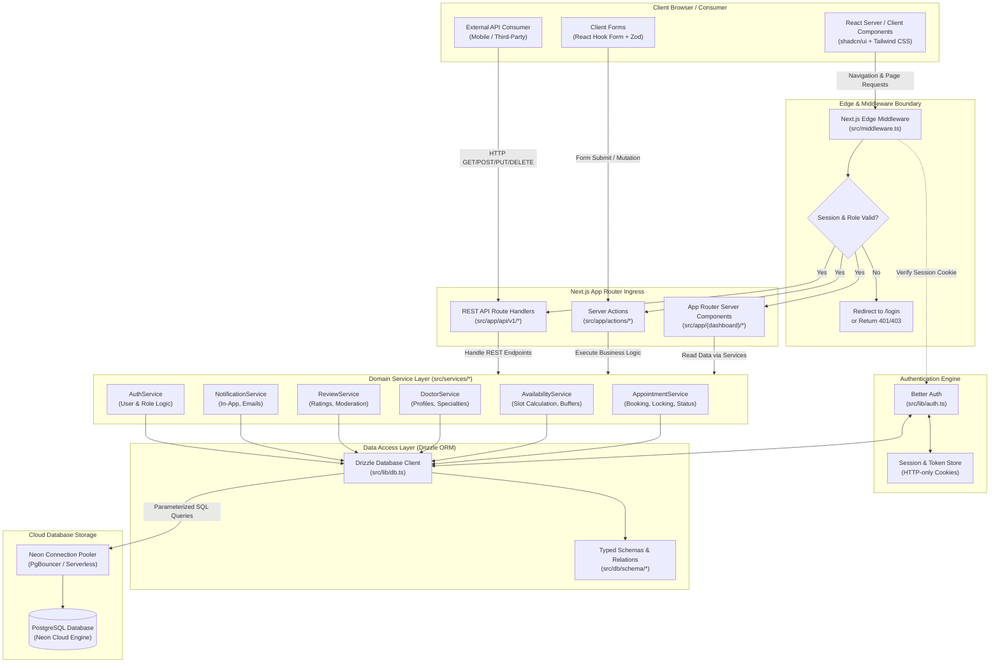
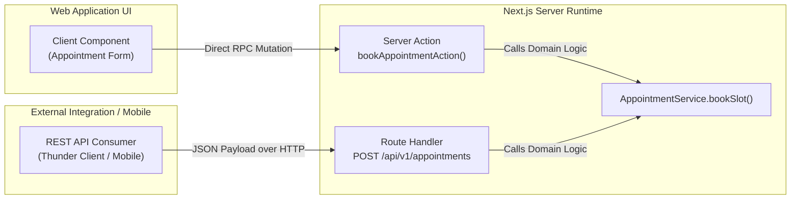
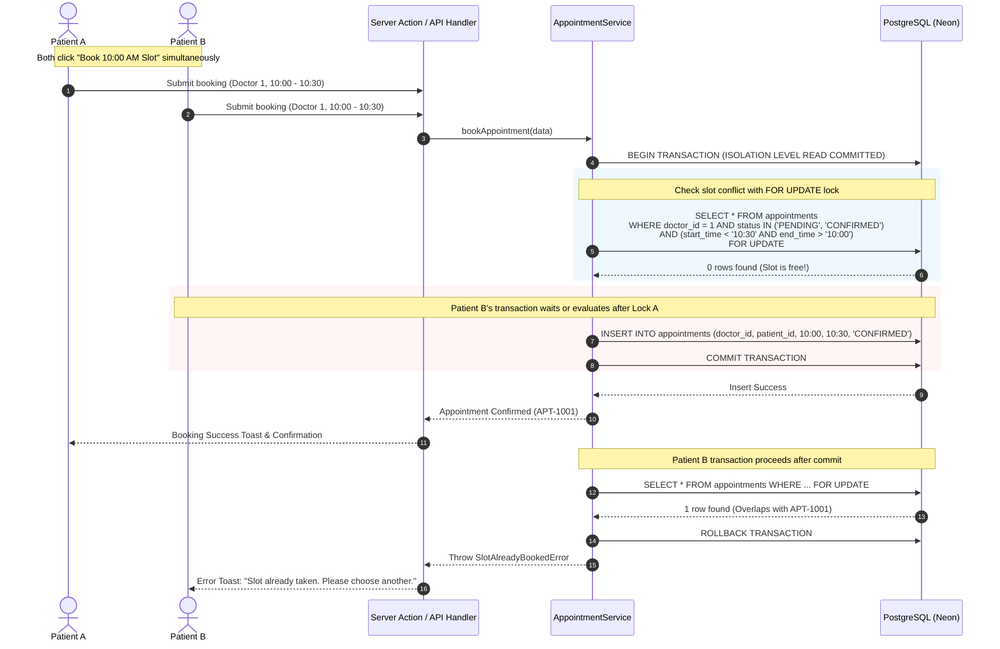
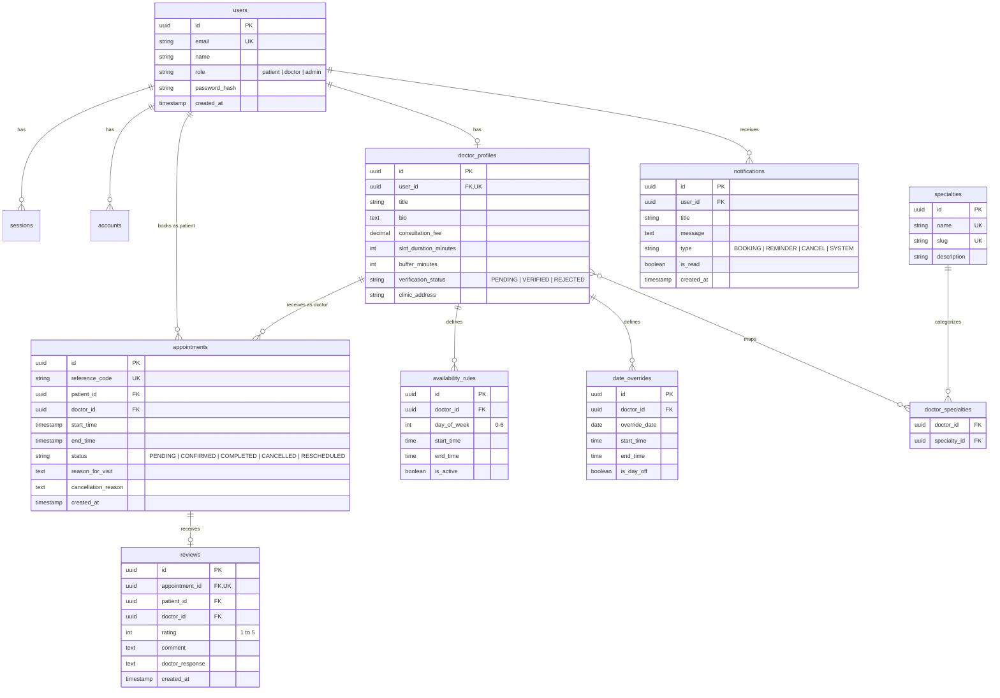

# System Architecture: Appointment Booking System

## 1. Architectural Overview

The **Appointment Booking System** is architected as a modern, unified full-stack application running on **Next.js 16 (App Router)** and **Node.js**. Rather than maintaining decoupled front-end and back-end microservices, the system adopts a modular **Layered Monolith Architecture**. 

This design leverages React Server Components (RSC) for data fetching, Next.js Server Actions for UI-driven mutations, and Route Handlers for public/partner REST APIs, all underpinned by an isolated **Domain Service Layer** and **Drizzle ORM** communicating with **PostgreSQL on Neon**.

---

## 2. System Architecture Diagram

The diagram below illustrates the end-to-end request flow, component interactions, authentication boundary, and data persistence layer:

---

## 3. Detailed Architectural Layers

### 3.1. Client & Presentation Layer
- **React Server Components (RSC)**: Used by default for all page views, dashboards, and static content. RSC fetches data on the server with zero client JavaScript bundle overhead.
- **Client Components (`'use client'`)**: Isolated exclusively to interactive widgets:
  - Dynamic calendar date & slot pickers (`BookingCalendar.tsx`).
  - Interactive forms powered by `react-hook-form` and `@hookform/resolvers/zod`.
  - Notification popovers, modals, and dynamic filter dropdowns.
- **Styling & UI**: Built on **Tailwind CSS v4** and **shadcn/ui** (accessible primitives from Radix UI).
- **Client-Side Notifications**: Handled via **Sonner** toasts for responsive feedback on mutation success, validation errors, and async processes.

### 3.2. Middleware & Routing Protection Layer
The middleware (`src/middleware.ts`) operates on the Next.js Edge Runtime before requests reach any page or route handler:
1. **Public Route Matching**: Permits unrestricted access to marketing pages, landing pages, doctor public profiles, login, and registration.
2. **Session Verification**: Extracts session tokens from HTTP-only cookies and verifies authenticity using Better Auth.
3. **Role-Based Routing Guard (RBAC)**:
   - Routes under `/dashboard/patient/*` require role `patient` or `admin`.
   - Routes under `/dashboard/doctor/*` require role `doctor` (and active `VERIFIED` status).
   - Routes under `/dashboard/admin/*` require role `admin`.
   - Unauthenticated or unauthorized requests trigger redirection to `/login` or return `401 Unauthorized` / `403 Forbidden` for API requests.

### 3.3. Ingress Layer: Server Actions vs. Route Handlers
The application implements two distinct ingress patterns catering to different client needs:

1. **Server Actions (`src/app/actions/*`)**:
   - Primary mutation mechanism for the web application.
   - Type-safe Remote Procedure Calls (RPC) directly callable from client components.
   - Built-in Progressive Enhancement and automatic cache revalidation (`revalidatePath`, `revalidateTag`).
2. **Route Handlers (`src/app/api/v1/*`)**:
   - Standard RESTful HTTP endpoints returning JSON responses with consistent HTTP status codes.
   - Supports external API consumers, automated integration testing (via Thunder Client), and mobile applications.

### 3.4. Domain Service Layer (`src/services/*`)
To avoid coupling business logic to either Server Actions or Route Handlers, all domain rules reside in the **Service Layer**:
- **Why a Service Layer?**
  - **DRY (Don't Repeat Yourself)**: Business logic, validation, and database operations are written once and shared across Server Actions and REST API endpoints.
  - **Transaction Boundary Management**: Complex multi-table operations (e.g., locking a slot, creating an appointment, logging an audit record, queuing an alert) are encapsulated in single service calls.
  - **Testability**: Service functions can be unit-tested in isolation without mocking HTTP requests or React component contexts.

**Core Services**:
- `AuthService`: User account registration, role queries, doctor verification status.
- `DoctorService`: Profile updates, specialty mappings, consultation fees, bio updates.
- `AvailabilityService`: Dynamic slot computation, buffer time calculation, holiday overrides.
- `AppointmentService`: Slot reservation, concurrency locking, cancellation, rescheduling.
- `ReviewService`: Post-consultation review submission, score calculation, response management.
- `NotificationService`: In-app notification creation, email dispatch coordination.

### 3.5. Data Access Layer (Drizzle ORM & Neon PostgreSQL)
- **Drizzle ORM**: Zero-runtime overhead TypeScript ORM.
  - Type-safe schema definition in `src/db/schema/*`.
  - Compile-time SQL query validation and inference of TypeScript types (`InsertAppointment`, `SelectAppointment`).
  - Drizzle Kit manages versioned database migrations in `drizzle/`.
- **Neon Serverless PostgreSQL**:
  - Connection pooling via Neon's connection pooler for serverless environments.
  - ACID transaction isolation guaranteeing data consistency.

---

## 4. Double-Booking Prevention & Concurrency Architecture

To guarantee that no two concurrent requests can reserve the same doctor slot, the system employs **pessimistic row-level locking** combined with **database transactions**:

### Key Concurrency Safeguards:
1. **Database Exclusion Constraint / Overlap Check**: In addition to row-level locks, PostgreSQL range constraints (`tsrange` with `gist` index) can enforce non-overlapping time slots at the database storage engine level.
2. **Status Scoping**: Only appointments with active statuses (`PENDING`, `CONFIRMED`) hold reservations. Cancelled appointments (`CANCELLED`) release the time slot immediately.

---

## 5. Entity Relationship Diagram (ERD)

---

## 6. Authentication & Security Architecture

1. **Better Auth Engine**:
   - Handles password hashing via modern memory-hard cryptographic algorithms (Argon2id or bcrypt).
   - Issues cryptographically random session tokens stored in secure, HTTP-only, SameSite cookies.
   - Seamlessly integrates with the PostgreSQL `users`, `sessions`, and `accounts` tables via Drizzle ORM.
2. **Defensive API Design**:
   - Strict Zod schema parsing on all request bodies, query params, and route parameters.
   - Parameterized SQL generation via Drizzle prevents SQL injection vectors entirely.
   - Cross-Site Request Forgery (CSRF) protection built into Next.js Server Actions and validated Origin headers on Route Handlers.
   - Comprehensive error masking: Database connection errors and query failures are caught by the service layer and translated into sanitized, client-safe error messages.
