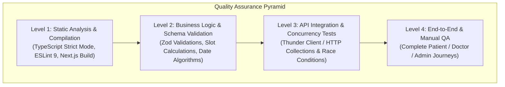

# Testing Strategy & Quality Assurance

This document details the multi-layered testing strategy, quality assurance standards, automation tooling, and validation checklists employed across the Appointment Booking System.

---

## 1. Testing Pyramid & Methodology

The system adopts a comprehensive testing approach balancing compile-time safety, runtime validation, automated API regression testing, and manual exploratory verification:



---

## 2. Level 1: Static Analysis & Type Checking

### 2.1. TypeScript Strict Type Verification
The project enforces strict type checking defined in [`tsconfig.json`](file:///c:/Users/Hp/OneDrive/Apps/appointment-booking/tsconfig.json) (`"strict": true`). This guarantees:
- No implicit `any` variables.
- Strict null and undefined checks.
- Compile-time verification of Drizzle ORM models and Better Auth sessions.

**Verification Command:**
```bash
npx tsc --noEmit
```

### 2.2. ESLint 9 Code Standards
Linting verifies code formatting, unused variables, and Next.js Best Practices via `eslint.config.mjs`:

**Verification Command:**
```bash
npm run lint
```

### 2.3. Production Build Compilation
Compiling the Next.js App Router tree ensures:
- React Server Component (RSC) and Client Component boundaries (`'use client'`) are strictly maintained.
- All dynamic routes (`/api/v1/*`, `/api/auth/[...all]`) serialize and bundle cleanly.
- Turbopack and Webpack optimizations succeed with zero unresolved imports.

**Verification Command:**
```bash
npm run build
```

---

## 3. Level 2: Business Logic & Schema Validation

### 3.1. Zod Validation Boundaries
All incoming payloads undergo strict runtime validation in [`src/lib/validations.ts`](file:///c:/Users/Hp/OneDrive/Apps/appointment-booking/src/lib/validations.ts).

Unit tests verify:
- Email formatting and password minimum lengths.
- Time range sanity (e.g., `endTime > startTime`).
- Date format regex (`^\d{4}-\d{2}-\d{2}$`).
- Doctor fee range limits (`0 < fee <= 10000`).

*Example validation test case:*
```typescript
import { availabilitySchema } from "@/lib/validations";

test("Rejects availability where end time is before start time", () => {
  const result = availabilitySchema.safeParse({
    dayOfWeek: "monday",
    startTime: "14:00",
    endTime: "10:00", // Invalid: Earlier than start
    slotDurationMinutes: 30,
  });

  expect(result.success).toBe(false);
  if (!result.success) {
    expect(result.error.issues[0].message).toContain("End time must be after start time");
  }
});
```

### 3.2. Slot Generation & Leave Collision Tests
Testing [`getAvailableSlots()`](file:///c:/Users/Hp/OneDrive/Apps/appointment-booking/src/services/appointment.service.ts#L18-L88) asserts:
- Returns an empty array when a doctor has no shift configured on a given weekday.
- Returns an empty array when the target date overlaps with `doctor_time_off`.
- Marks slots occupied when non-cancelled appointments exist for that time.

---

## 4. Level 3: API Integration & Concurrency Testing

### 4.1. Thunder Client Test Automation
Automated test scripts in Thunder Client assert:
1. **Status Code Verification**: Every successful endpoint returns `200` or `201`.
2. **Payload Structure**: Verifies `{ "success": true, "data": ... }`.
3. **Authorization Rejection**: Calling `/api/v1/admin/*` without an admin session cookie immediately returns `401 Unauthorized` or `403 Forbidden`.

### 4.2. Concurrency & Race Condition Verification
Simulating simultaneous bookings for the identical doctor slot validates the database-level unique constraint (`idx_unique_doctor_slot`):

```bash
# Parallel execution script (PowerShell)
$body = '{"doctorId":"d1a11111-2222-3333-4444-555555555555","appointmentDate":"2026-11-05","startTime":"10:00","endTime":"10:30","reason":"Checkup"}'

1..5 | ForEach-Object -Parallel {
  Invoke-RestMethod -Uri "http://localhost:3000/api/v1/appointments" `
    -Method POST -Body $using:body -ContentType "application/json" -WebSession $session
}
```
**Expected Outcome**: Exactly 1 request succeeds with `201 Created`. The remaining 4 requests receive `409 Conflict` ("This time slot was just booked by another patient").

---

## 5. Level 4: Comprehensive Manual QA Checklist

### 5.1. Patient Journey Matrix
- [ ] Register new account with role `patient`.
- [ ] Log in and verify session cookie is set.
- [ ] Browse doctor directory with specialty and search filters.
- [ ] Open doctor detail profile and view credentials, ratings, and fee.
- [ ] Select a calendar date and observe dynamic slots rendered.
- [ ] Reserve an available slot and confirm redirect to booking confirmation.
- [ ] View booking under **My Appointments**.
- [ ] Reschedule the appointment to a different date.
- [ ] Cancel the appointment and verify slot becomes available again for others.
- [ ] Submit review for a completed consultation.

### 5.2. Doctor Journey Matrix
- [ ] Register new doctor account and complete onboarding profile (bio, fee, specialty).
- [ ] Configure weekly working shifts (e.g. Mon–Fri 09:00–17:00, 30-min slots).
- [ ] Add a vacation leave range under **Time-Off** and verify public slots for those dates are disabled.
- [ ] Receive in-app notification when patient books a slot.
- [ ] Confirm appointment.
- [ ] Conclude consultation and mark appointment as `completed` with clinical notes.
- [ ] Verify doctor profile rating updates when a patient submits a review.

### 5.3. Platform Administrator Matrix
- [ ] Access `/admin/stats` and verify platform metrics (total users, bookings, completed, revenue).
- [ ] View user list and toggle user role between `patient` and `doctor`.
- [ ] Create and update medical specialties.
- [ ] Inspect system-wide appointment logs.

---

## 6. Continuous Integration (CI) Workflow

Below is the recommended GitHub Actions workflow (`.github/workflows/ci.yml`) enforcing code health on every pull request:

```yaml
name: CI Suite

on:
  push:
    branches: [main, master]
  pull_request:
    branches: [main, master]

jobs:
  validate:
    runs-on: ubuntu-latest
    steps:
      - name: Checkout Code
        uses: actions/checkout@v4

      - name: Setup Node.js 20
        uses: actions/setup-node@v4
        with:
          node-version: 20
          cache: "npm"

      - name: Install Dependencies
        run: npm ci

      - name: TypeScript Type-Check
        run: npx tsc --noEmit

      - name: Run ESLint
        run: npm run lint

      - name: Verify Production Build
        run: npm run build
        env:
          DATABASE_URL: ${{ secrets.DATABASE_URL }}
          BETTER_AUTH_SECRET: ${{ secrets.BETTER_AUTH_SECRET }}
          BETTER_AUTH_URL: http://localhost:3000
          NEXT_PUBLIC_APP_URL: http://localhost:3000
```
