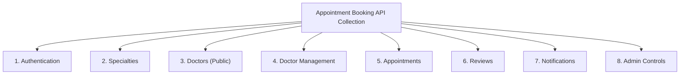

# Thunder Client API Testing Guide

This guide explains how to set up, configure, and execute automated and exploratory REST API tests for the Appointment Booking System using **Thunder Client** (the lightweight VS Code extension).

---

## 1. What is Thunder Client?

[Thunder Client](https://www.thunderclient.com/) is an integrated REST API client extension for Visual Studio Code. It provides a lightweight, GUI-driven alternative to Postman with built-in environment variable handling, cookie persistence, and test scripting.

### Installing Thunder Client:
1. Open VS Code.
2. Navigate to the Extensions panel (`Ctrl + Shift + X` on Windows / `Cmd + Shift + X` on macOS).
3. Search for `Thunder Client` (by Ranga Vadhineni) and click **Install**.
4. The Thunder Client lightning icon appears in the VS Code Activity Bar.

---

## 2. Environment Configuration

To test seamlessly across different user roles (`patient`, `doctor`, `admin`), create an Environment in Thunder Client.

### 2.1. Create Environment
1. In the Thunder Client panel, select the **Env** tab.
2. Click **New Environment** and name it `Appointment Booking - Local`.
3. Add the following variables:

| Variable Name | Initial Value | Description |
| :--- | :--- | :--- |
| `baseUrl` | `http://localhost:3000` | Local development host |
| `patientEmail` | `patient.test@example.com` | Test patient login email |
| `patientPassword` | `Password123!` | Test patient password |
| `doctorEmail` | `dr.jenkins@example.com` | Test doctor login email |
| `doctorPassword` | `DoctorPassword123!` | Test doctor password |
| `adminEmail` | `admin@example.com` | Test platform administrator email |
| `adminPassword` | `AdminPassword123!` | Test admin password |
| `specialtyId` | `a0eebc99-9c0b-4ef8-bb6d-6bb9bd380a11` | Seeded specialty UUID |
| `doctorId` | `d1a11111-2222-3333-4444-555555555555` | Test doctor profile UUID |
| `appointmentId` | `apt_placeholder_id` | Set dynamically during tests |

4. Click **Save** and select `Appointment Booking - Local` as the **Active Environment** from the top dropdown.

---

## 3. Session & Cookie Authentication in Thunder Client

The system utilizes [Better Auth](file:///c:/Users/Hp/OneDrive/Apps/appointment-booking/src/lib/auth.ts), which manages authentication using HTTP-only cookies (`better-auth.session_token`).

### How Cookie Persistence Works:
1. When you execute **Sign In** (`POST {{baseUrl}}/api/auth/sign-in`), the server returns a `Set-Cookie` header containing the session token.
2. Thunder Client automatically stores this cookie in its internal cookie jar for the domain `localhost`.
3. Subsequent requests within the same Thunder Client session automatically attach this cookie, authenticating you as that user.
4. To switch roles (e.g. from `patient` to `doctor`), execute **Sign Out** or execute **Sign In** with the new user's credentials to overwrite the active session cookie.

---

## 4. Collection Structure

Organize your Thunder Client requests into the following logical folders:



---

## 5. Detailed Request Catalog

### Folder 1: Authentication

#### 1.1. Sign Up (Patient)
- **Method**: `POST`
- **URL**: `{{baseUrl}}/api/auth/sign-up`
- **Body (JSON)**:
  ```json
  {
    "name": "Alex Patient",
    "email": "{{patientEmail}}",
    "password": "{{patientPassword}}",
    "role": "patient",
    "phone": "+1-555-0101"
  }
  ```
- **Tests**:
  - Status code is `200` or `201`
  - Response body contains `user`

#### 1.2. Sign In (Patient)
- **Method**: `POST`
- **URL**: `{{baseUrl}}/api/auth/sign-in`
- **Body (JSON)**:
  ```json
  {
    "email": "{{patientEmail}}",
    "password": "{{patientPassword}}"
  }
  ```
- **Tests**:
  - Status code is `200`
  - Response body contains `token`

#### 1.3. Get Session
- **Method**: `GET`
- **URL**: `{{baseUrl}}/api/auth/get-session`
- **Tests**:
  - Status code is `200`
  - `json.user.role === "patient"`

#### 1.4. Sign Out
- **Method**: `POST`
- **URL**: `{{baseUrl}}/api/auth/sign-out`
- **Tests**:
  - Status code is `200`

---

### Folder 2: Specialties

#### 2.1. List Specialties
- **Method**: `GET`
- **URL**: `{{baseUrl}}/api/v1/specialties`
- **Tests**:
  - Status code is `200`
  - `json.success === true`

#### 2.2. Create Specialty (Admin Only)
- **Method**: `POST`
- **URL**: `{{baseUrl}}/api/v1/specialties`
- **Body (JSON)**:
  ```json
  {
    "name": "Orthopedics",
    "description": "Bones, joints, and musculoskeletal care",
    "icon": "Bone"
  }
  ```

---

### Folder 3: Doctors (Public Discovery)

#### 3.1. Search Doctors
- **Method**: `GET`
- **URL**: `{{baseUrl}}/api/v1/doctors?search=Sarah&page=1&limit=10`
- **Tests**:
  - Status code is `200`
  - `json.data.items` is array

#### 3.2. Get Doctor By ID
- **Method**: `GET`
- **URL**: `{{baseUrl}}/api/v1/doctors/{{doctorId}}`

#### 3.3. Get Real-Time Time Slots
- **Method**: `GET`
- **URL**: `{{baseUrl}}/api/v1/doctors/{{doctorId}}/slots?date=2026-11-05`
- **Tests**:
  - Status code is `200`
  - Each item contains `start`, `end`, and `isAvailable` boolean

---

### Folder 4: Doctor Schedule Management

#### 4.1. Set Weekly Availability Shift
- **Method**: `POST`
- **URL**: `{{baseUrl}}/api/v1/doctors/availability`
- **Body (JSON)**:
  ```json
  {
    "dayOfWeek": "thursday",
    "startTime": "09:00",
    "endTime": "17:00",
    "slotDurationMinutes": 30
  }
  ```

---

### Folder 5: Appointments

#### 5.1. Book Appointment
- **Method**: `POST`
- **URL**: `{{baseUrl}}/api/v1/appointments`
- **Body (JSON)**:
  ```json
  {
    "doctorId": "{{doctorId}}",
    "appointmentDate": "2026-11-05",
    "startTime": "10:00",
    "endTime": "10:30",
    "reason": "Routine clinical checkup"
  }
  ```
- **Tests**:
  - Status code is `201`
  - Set Environment variable: `appointmentId = json.data.id`

#### 5.2. Double-Booking Concurrency Test (Duplicate Booking)
- Run request 5.1 again with identical slot:
- **Tests**:
  - Status code is `409`
  - `json.error` contains `"This time slot was just booked"`

#### 5.3. Cancel Appointment
- **Method**: `POST`
- **URL**: `{{baseUrl}}/api/v1/appointments/{{appointmentId}}/cancel`
- **Body (JSON)**:
  ```json
  {
    "reason": "Sudden emergency reschedule needed"
  }
  ```

---

### Folder 6: Reviews

#### 6.1. Submit Review (Post-Consultation)
- **Method**: `POST`
- **URL**: `{{baseUrl}}/api/v1/reviews`
- **Body (JSON)**:
  ```json
  {
    "appointmentId": "{{appointmentId}}",
    "rating": 5,
    "comment": "Doctor provided outstanding care and insight."
  }
  ```

---

### Folder 7: Notifications

#### 7.1. List Notifications
- **Method**: `GET`
- **URL**: `{{baseUrl}}/api/v1/notifications?page=1&limit=20`

#### 7.2. Mark All as Read
- **Method**: `POST`
- **URL**: `{{baseUrl}}/api/v1/notifications/read-all`

---

### Folder 8: Admin Analytics & Governance

#### 8.1. Get Administrative Statistics
- **Method**: `GET`
- **URL**: `{{baseUrl}}/api/v1/admin/stats`
- **Tests**:
  - Status code is `200`
  - `json.data.totalAppointments` is number

#### 8.2. Update User Role
- **Method**: `PUT`
- **URL**: `{{baseUrl}}/api/v1/admin/users/{{patientId}}/role`
- **Body (JSON)**:
  ```json
  {
    "role": "doctor"
  }
  ```

---

## 6. Ready-to-Import Collection JSON

To import this entire suite instantly into Thunder Client:
1. In Thunder Client, click the **Collections** tab.
2. Click **Menu (top right) > Import**.
3. Choose **JSON** and paste the manifest below:

```json
{
  "clientName": "Thunder Client",
  "collectionName": "Appointment Booking System",
  "collectionId": "col_apt_booking_v1",
  "dateExported": "2026-10-28",
  "version": "1.1",
  "folders": [
    { "_id": "f_auth", "name": "1. Authentication" },
    { "_id": "f_specs", "name": "2. Specialties" },
    { "_id": "f_docs", "name": "3. Doctors (Public)" },
    { "_id": "f_apts", "name": "4. Appointments" },
    { "_id": "f_admin", "name": "5. Admin" }
  ],
  "requests": [
    {
      "_id": "req_1",
      "colId": "col_apt_booking_v1",
      "containerId": "f_auth",
      "name": "Sign In (Patient)",
      "url": "{{baseUrl}}/api/auth/sign-in",
      "method": "POST",
      "body": {
        "type": "json",
        "raw": "{\n  \"email\": \"{{patientEmail}}\",\n  \"password\": \"{{patientPassword}}\"\n}"
      }
    },
    {
      "_id": "req_2",
      "colId": "col_apt_booking_v1",
      "containerId": "f_specs",
      "name": "List Specialties",
      "url": "{{baseUrl}}/api/v1/specialties",
      "method": "GET"
    },
    {
      "_id": "req_3",
      "colId": "col_apt_booking_v1",
      "containerId": "f_apts",
      "name": "Get User Appointments",
      "url": "{{baseUrl}}/api/v1/appointments?status=scheduled",
      "method": "GET"
    },
    {
      "_id": "req_4",
      "colId": "col_apt_booking_v1",
      "containerId": "f_admin",
      "name": "Get Admin Stats",
      "url": "{{baseUrl}}/api/v1/admin/stats",
      "method": "GET"
    }
  ]
}
```
